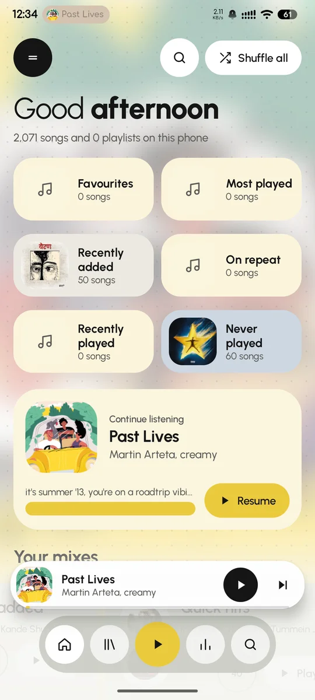
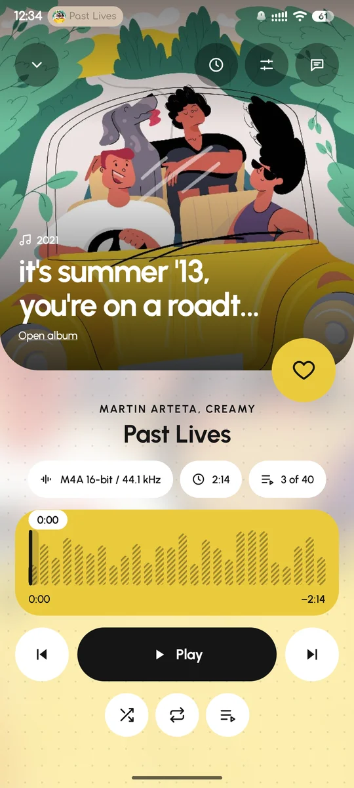
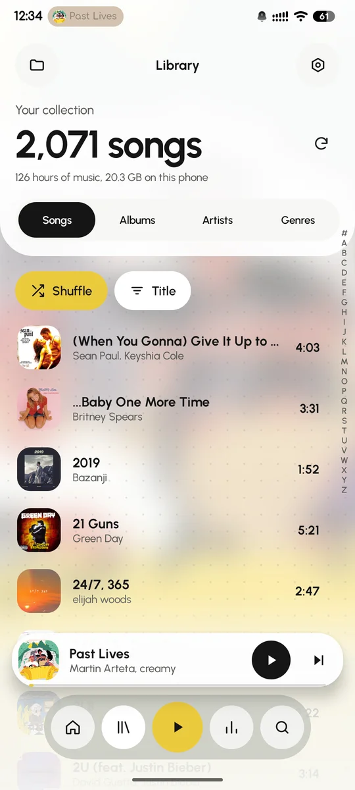
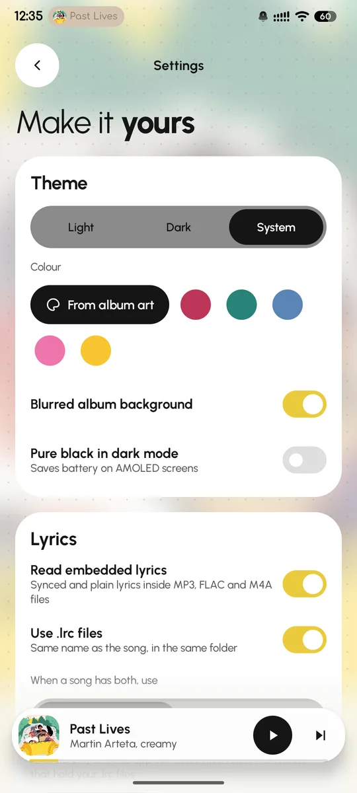

<div align="center">


# Kairos Online

**Kairos, plus YouTube Music and YouTube (audio only): streaming, one Home for online and local music, downloads and synced lyrics, in the same player.**

[](https://github.com/Arif1221/kairos-online/releases)
[](https://github.com/Arif1221/kairos-online/actions/workflows/build.yml)
[](#requirements)
[](LICENSE)

[Download the APK](https://github.com/Arif1221/kairos-online/releases) · [Report a bug](https://github.com/Arif1221/kairos-online/issues/new?template=bug_report.yml) · [Request a feature](https://github.com/Arif1221/kairos-online/issues/new?template=feature_request.yml)

</div>

> This is **Kairos Online**, in its own repository. The offline app (Play Store) is [Arif1221/kairos](https://github.com/Arif1221/kairos). Offline features are built there and merged in here; nothing goes back.

Kairos Online plays the music already on your phone (MP3, FLAC, M4A/AAC, OGG, Opus, WAV) and streams from YouTube Music and YouTube. No account, no ads, no tracking. It is built with Jetpack Compose and Media3 (ExoPlayer).

<p align="center">
  
  
  
  
</p>
<p align="center"><sub>Screens shared with offline Kairos.</sub></p>

## Features

**Lyrics**
- Time-synced lyrics with a karaoke-style fill that moves line by line, start to finish
- Reads lyrics embedded in the file (MP3 `USLT`/`SYLT`, FLAC Vorbis comments, M4A `©lyr`) and `.lrc` files next to your songs
- Word-level timestamps, `[offset]` tags, and a per-song timing fix in 0.1 s steps
- Tap a line to jump there
- Fetch missing lyrics from LRCLIB (synced or plain, your pick), keep them in the app, or save them as `.lrc` next to the song
- Share one or several lines as an image card in the album's colours

**Sound**
- Hi-res output (32-bit float) and bit-perfect USB output on Android 14+
- 10-band equalizer, bass boost and virtualizer
- ReplayGain (track and album), gapless playback
- Sleep timer that can fade out or stop at the end of the song

**Library**
- Songs, albums, artists and genres, with an A–Z fast scroller
- Songs with several artists ("A feat. B") show under each of them
- Choose which folders to scan; skip short clips
- Playlists, favourites, and auto playlists: Most played, On repeat, Recently added, Forgotten gems, genre mixes and more
- Listening stats: time listened, top songs and artists, streaks, and a year-in-review story
- Song radio and Smart Shuffle built from what you play together, with artists and albums spread out
- Drag to reorder the queue; shake to reshuffle what's coming up
- Backup and restore of favourites, playlists, history and settings to one file

**Design**
- The whole app takes its accent colour from the cover that is playing
- One player surface: swipe the mini player up into the full player and back down
- Swipe the cover to change song; swipe rows to play next or remove
- A living background: the album art drifts and breathes behind every screen while music plays
- Vinyl mode for the player, an edge glow with each new song, and a "Kairos moment" when the chorus hits
- Light, dark and pure-black themes

## Download

Get `app-online-release.apk` from the latest `v*-online` release on [Releases](https://github.com/Arif1221/kairos-online/releases). Kairos Online is not on the Play Store and never will be (it streams through an unofficial YouTube API). It installs next to offline Kairos (`com.skarif.kairos.online`).

> Builds up to 0.7.5.2-online were signed with a retired key. If one is installed, uninstall it once before installing 0.7.6.1-online or later.

### Requirements
Android 9 (API 28) or newer. Bit-perfect USB output needs Android 14.

## Privacy

Kairos Online collects nothing and has no account. To stream, it talks to YouTube (search, stream URLs, audio; and, for Home, the titles and artists of the songs you play most) and to [LRCLIB](https://lrclib.net) (lyrics); those services see your IP address and what you search or play, as with any client. Your library, playlists, history and the stream cache stay on your phone. Read the full [privacy policy](PRIVACY.md).

## Online

### How the online build is set up
This repo keeps two Gradle flavors so the offline repo's code merges in cleanly:
- `online` (`assembleOnlineRelease`): what this repo builds and releases.
- `play`: the offline app, kept only so shared code compiles both ways. It isn't built or released here.

### Online features

- **Same dock as offline Kairos**: Home · Library · ▶ Now playing · Stats · Search.
- **Home** (streaming and your phone together): **Quick picks** woven from YouTube mixes of the songs you play most, **Jump back in** (streamed and local), **Your downloads**, **Made for you** mixes, then **Your artists**, **Playlists for you**, **New releases** and **Charts**. Mood chips (Chill, Party, Focus, Bollywood, Lo-fi...) switch Home to playlists and songs for that mood. Online shelves are saved on the phone, so Home opens instantly and refreshes every 6 hours.
- **Library**: tiles for **Favourites, Playlists, Downloads and Recently played** (streamed or not) above the music files on this phone.
- **Search**: one box for YouTube Music and this phone. Matches on this phone come first; chips filter **Songs, Videos, Artists, Albums & playlists** or **On this phone**. Suggestions as you type, more results as you scroll. Where YouTube Music's song search comes back empty, music videos are ranked instead (official audio first; covers, reactions, mashups and jukeboxes last) and their titles tidied ("Artist - Song (Official Video)" becomes "Song" by "Artist").
- **Tips** on Home, Library, Search and Downloads explain what each part does; close them once, or bring them back in Settings.
- **In-app updates**: when a new version is out, a popup shows what's new; **Update now** downloads it and installs it over the current version. On Android 12+ that needs no confirmation once you've let Kairos install updates (asked the first time). Android only installs it if it's signed with the same key.
- **Album, playlist and artist pages** for online results, with Play, Shuffle, Radio and **Save** (as one of your playlists).
- **Online radio**: tapping an online song plays it with its YouTube mix after it, and autoplay continues an online queue the same way. Local songs keep the library radio.
- Videos play as **audio only**; video streams are never downloaded. Shorts are skipped.
- **Settings > Streaming**: Data saver (~50 kbps), Normal (~128 kbps) or High (~160 kbps Opus), plus "Data saver on mobile data" (default on), and an **Online check** that tries search, radio and playback once and shows what works on your network.
- **Save to phone**: online songs, albums and playlists as **M4A files in Music/Kairos**, tagged with title, artist and cover, so any app can play them.
- **Downloads**: tap the download button on any online song (or in the player), or hold a song and tap **Download**, or use **Download all** on an album, playlist or artist page. Downloads are kept until you remove them (separate from the stream cache) and live under Library > Downloads and on Home.
- **Works offline after streaming**: played songs are kept in a 1 GB stream cache (oldest go first) and replay with no connection. Home shows them when you're offline.
- **Synced lyrics** for online songs from [LRCLIB](https://lrclib.net) (free, no key), with the same download panel as local songs.
- **Reliability**: YouTube requests are retried once; a song that fails to load is skipped (up to 3 in a row) instead of stopping playback. Search and Home show an offline state and reload when the connection returns.
- **Welcome screens** for the online build: streaming in the tour, and **Just stream from YouTube Music**, which needs no music permission.
- Sharing an online song shares its YouTube Music link.
- Online songs can be favourited, added to playlists, queued, and count in Stats. No ReplayGain for them (no file to read).

### How it is wired

- `main/.../online/OnlineMusic.kt` is the only thing shared code knows about. `Flavor.online` is `null` in `src/play` and `YouTubeMusic` in `src/online`.
- Online songs are normal `songs` rows with a **negative id** and `volume = "online"`, so favourites, playlists, stats and the queue need no special cases. They are saved only once played, favourited or added to a playlist, and never appear in the Library.
- Online state that isn't playback (Home shelves, online search, network, cache) lives in `ui/OnlineFeatures.kt`, not `MainViewModel`, so merges from main stay small.
- Playback goes through `RoutingDataSource`: local Uris go straight to the file, and `kairos-yt:` Uris go through `CacheDataSource` and then `ResolvingDataSource` (the stream URL is only fetched for bytes not in the cache). Each song's quality is pinned the first time it's opened, because seeking reopens the stream at a byte offset and a quality change mid-song would corrupt it.
- Quality is read each time a stream opens (`dataSourceFactory(context, quality)`), so the setting and Wi-Fi/mobile changes apply from the next song. Resolved URLs are cached per song and quality for 3 hours.
- Stream URLs expire, so the player gets `kairos-yt:<videoId>` and a `ResolvingDataSource` swaps in a fresh URL when the song is opened.
- YouTube access goes through [NewPipeExtractor](https://github.com/TeamNewPipe/NewPipeExtractor) (unofficial). When streaming breaks, bump `newpipeExtractor` in `gradle/libs.versions.toml` first.

> NewPipeExtractor is GPL-3.0, so the online APK must be distributed under the GPL-3.0.

### Keeping up with the offline app
```
git remote add offline https://github.com/Arif1221/kairos.git   # once
git fetch offline
git merge offline/main
```
Conflicts to expect: `versionCode`/`versionName` (keep online's numbering, ahead of offline), `.github/workflows/build.yml` (keep this repo's), and `MainViewModel.mixes` (the favourites mix must read `byId`, which includes saved online songs).

## Build from source

You need Android Studio Ladybug (2024.2) or newer, or JDK 17 and the Android SDK.

```bash
git clone https://github.com/Arif1221/kairos-online.git
cd kairos-online
./gradlew assembleDebug          # debug APK in app/build/outputs/apk/debug/
./gradlew testReleaseUnitTest    # unit tests (lyrics parser)
```

Release builds are signed in CI with a key stored in GitHub secrets. Local release builds without that key are signed with your debug key, so they install on your own phone.

## How it is built

| Part | What it uses |
|---|---|
| UI | Jetpack Compose, Material 3, one `MainViewModel` exposing `StateFlow`s |
| Playback | Media3 ExoPlayer in a `MediaSessionService` (notification, lock screen, headset buttons) |
| Library | MediaStore scan into Room; settings in DataStore |
| Lyrics | A tag reader and LRC parser in plain Java, with no Android imports, so they run in unit tests |
| Colour | Palette API: the accent is the colour that covers the most of the cover |
| Audio | `DynamicsProcessing` EQ, float output, `AudioManager` mixer attributes for bit-perfect USB |

```
app/src/main/java/com/skarif/kairos/
├── ui/          screens, player layer, theme, motion tokens, components
├── playback/    PlaybackService, PlayerConnection, AudioEffects, BitPerfect
├── data/        Room database, MediaScanner, SettingsStore, Lyrics and Artwork repositories
└── lyrics/      TagReader and LrcParser (pure Java)
```

## Developer


**SK Arif Hossain** builds Kairos on his own: design, code and releases. B.Tech IT student from West Bengal, India.

[Instagram](https://www.instagram.com/seeking.starlight) · [GitHub](https://github.com/Arif1221) · [LinkedIn](https://www.linkedin.com/in/skarifhossain-it)

<br clear="left" />

## Contributing

Bug reports, ideas and pull requests are welcome. Please read [CONTRIBUTING.md](CONTRIBUTING.md) first. For security issues, see [SECURITY.md](SECURITY.md).

## Credits

Kairos Online is built with these, and thanks everyone behind them:

| Project | By | Licence |
|---|---|---|
| [Kotlin](https://kotlinlang.org) and kotlinx.coroutines | JetBrains | Apache 2.0 |
| [Jetpack Compose](https://developer.android.com/jetpack/compose), Material 3, AndroidX (Core, Activity, Lifecycle, Navigation) | Google, Android Open Source Project | Apache 2.0 |
| [Media3](https://developer.android.com/media/media3): ExoPlayer, MediaSession, cache | Google, Android Open Source Project | Apache 2.0 |
| Room, DataStore, Palette | Google, Android Open Source Project | Apache 2.0 |
| [Guava](https://github.com/google/guava) | Google | Apache 2.0 |
| [NewPipe Extractor](https://github.com/TeamNewPipe/NewPipeExtractor) | Team NewPipe | GPL 3.0 |
| [OkHttp](https://square.github.io/okhttp/) and Okio | Square | Apache 2.0 |
| [Rhino](https://github.com/mozilla/rhino) | Mozilla | MPL 2.0 |
| [jsoup](https://jsoup.org) | Jonathan Hedley | MIT |
| [nanojson](https://github.com/mmastrac/nanojson) | Matt Mastracci | MIT / Apache 2.0 |
| [Protocol Buffers Lite](https://protobuf.dev) | Google | BSD 3-Clause |
| [desugar_jdk_libs](https://github.com/google/desugar_jdk_libs) | Google | GPL 2.0 with Classpath Exception |
| [Urbanist](https://github.com/coreyhu/Urbanist) font | Corey Hu | SIL OFL 1.1 |
| [LRCLIB](https://lrclib.net) lyrics | LRCLIB | Free public API |
| YouTube Music and YouTube | Google (Kairos is not affiliated) | Content source |

The same list is in the app under Settings > Credits.

## License

Copyright © 2026 SK Arif Hossain. Kairos Online is free software under the [GNU General Public License v3.0](LICENSE) (it has to be: NewPipe Extractor is GPL-3.0). **Use it, change it, share it, but credit it:** under the extra terms in [NOTICE](NOTICE), anything based on this code must keep that file and show "Based on Kairos by SK Arif Hossain" in its credits, and may not use the Kairos name or icon.

The Urbanist font is under the [SIL Open Font License](app/src/main/assets/licenses/urbanist-OFL.txt).
